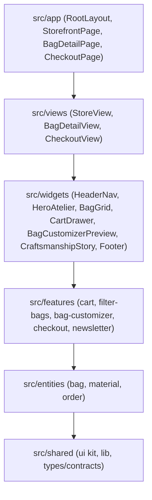

# Swarm Wave 1 — Reconnaissance & Task Graph (DAG)

## 1. Domain & Architecture Mapping
- **System**: Atelier Véloce — E-Commerce Bag Store & Bespoke Leather Customizer
- **Framework**: Next.js 15+ App Router, React 19, TypeScript 5, Tailwind CSS 4, Motion (`motion/react`), Zod
- **Architectural Standard**: Feature-Sliced Design (FSD) with 6 strict layers and downward-only imports:
  `app` -> `views` -> `widgets` -> `features` -> `entities` -> `shared`
- **File Length Ceiling**: Maximum 250 LOC per file across all `.ts`/`.tsx` modules.

## 2. Component Dependency Graph


## 3. Database & Entity Schema Inventory
- **Bag Entity**:
  - `id`: string (UUID or slug: `le-flaneur-tote`, `l-arche-briefcase`, `le-nomade-weekender`, `le-messager-sling`, `le-porte-folio`)
  - `name`: string
  - `tagline`: string
  - `category`: "tote" | "briefcase" | "weekender" | "crossbody" | "accessory"
  - `price`: number (base price in EUR)
  - `capacityLiters`: number
  - `weightGrams`: number
  - `dimensions`: { widthMm: number; heightMm: number; depthMm: number }
  - `description`: string
  - `materials`: string[] (e.g. "Full-Grain Italian Box Calf", "Ballistic Cordura 1050D")
  - `hardwareOptions`: HardwareVariant[] ("Solid Brass", "Matte Palladium", "Black PVD")
  - `colorVariants`: ColorVariant[] ("Cognac", "Obsidian Black", "Olive Drab", "Saddle Tan")
  - `featured`: boolean
  - `inStock`: boolean
  - `rating`: number
  - `reviewsCount`: number
  - `images`: string[]
- **Cart Entity / State**:
  - `items`: Array<{ bagId: string; selectedColor: string; selectedHardware: string; monogram?: string; quantity: number }>
  - `couponCode`?: string
  - `discountPercent`: number
- **Order Entity**:
  - `id`: string
  - `createdAt`: string
  - `customer`: { fullName: string; email: string; shippingAddress: Address }
  - `items`: CartItem[]
  - `subtotal`: number
  - `shipping`: number
  - `total`: number
  - `status`: "confirmed" | "in_crafting" | "shipped"

## 4. Directed Acyclic Graph (DAG) for Wave 3 Parallel Implementation
```mermaid
graph LR
  subgraph Wave2 [Wave 2: Contract Freeze]
    T1[Shared Types & Contracts: @/shared/types]
  end

  subgraph Wave3 [Wave 3: Mass Parallel Implementation]
    T1 --> D1[Entities: bag, material, order]
    T1 --> D2[Shared UI Primitives: Button, Drawer, Modal, Input, Badge]
    D1 & D2 --> F1[Features: cart state & actions]
    D1 & D2 --> F2[Features: bag-filter & search]
    D1 & D2 --> F3[Features: bag-customizer]
    D1 & D2 --> F4[Features: checkout & zod action]
    F1 & F2 & F3 & F4 --> W1[Widgets: HeaderNav, CartDrawer]
    F1 & F2 & F3 & F4 --> W2[Widgets: BagGrid, HeroAtelier, CraftStory]
    W1 & W2 --> V1[Views: StoreView, BagDetailView, CheckoutView]
    V1 --> A1[App Routes: /, /bags/[slug], /checkout]
  end

  subgraph Wave4 [Wave 4: Topological Integration]
    A1 --> M1[Public API Barrels & Downward Import Audit]
  end

  subgraph Wave5 [Wave 5: Adversarial QA & Release]
    M1 --> Q1[npx tsc --noEmit && npm run build]
    Q1 --> Q2[Security Audit & Secret Scan]
  end
```
