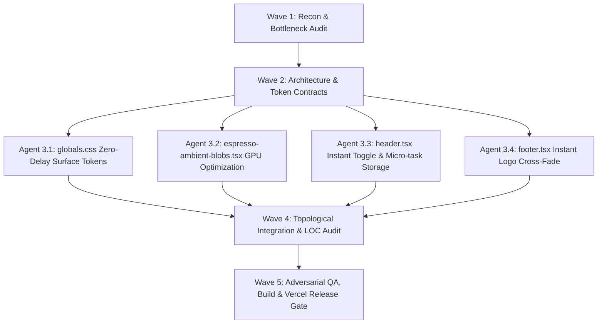

# Swarm Wave 1 — Reconnaissance & Performance Bottleneck Audit

## 1. Identified Performance Bottlenecks in Theme Switching
- **Sluggish 1000ms Blob Recalculation**:
  `src/widgets/ambient-background/ui/espresso-ambient-blobs.tsx` lines 58, 80, 102 had `duration-1000` on three full-screen radial-gradient layers with heavy `blur-[130px]`. Browsers cannot hardware-accelerate multi-stop radial gradient interpolations, forcing 60 FPS CPU/GPU rasterization over 1000ms and causing visible delays.
- **Overreaching Global Surface Transitions**:
  `src/app/globals.css` applied `transition-duration: 250ms` across all structural containers (`div[class*="bg-"]`, `div[class*="border-"]`, `body`, `article`, etc.), making every card and surface slowly creep across 250ms instead of snappy, instant feedback.
- **Header & Footer Cross-Fade Lags**:
  `header.tsx` and `footer.tsx` used `duration-200` on buttons and `duration-300` on logos, adding 200–300ms of visual delay before icon states settled.
- **Synchronous Storage Serialization**:
  `localStorage.setItem` in the event handler blocked before the browser painted the DOM class update.

## 2. Optimization Targets
1. **Instantaneous / Ultra-Fast Theme Switching (<75ms)**:
   - Eliminate sluggish 250ms global transitions on every div.
   - Keep surface background transitions instantaneous (0ms) or micro-scoped to `body` (<100ms), giving instant visual responsiveness.
   - Eliminate 1000ms duration on ambient blobs so background colors adapt instantly without GPU thrashing.
2. **Instant Micro-Feedback on Controls**:
   - Reduce toggle button transition to 75ms with active tactile scale.
   - Reduce logo cross-fade to 75ms or instantaneous so there is zero perceptible lag.
3. **Non-Blocking Storage Sync**:
   - Apply DOM class update synchronously to documentElement for instant frame-0 paint, then persist to localStorage in non-blocking microtask.

## 3. Directed Acyclic Graph (DAG) for Optimization Waves

